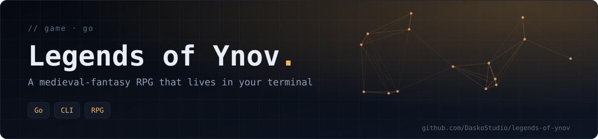
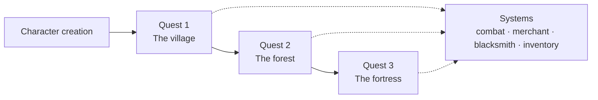

<div align="center">



**A medieval-fantasy role-playing game played entirely in the terminal, written in Go: story chapters, character classes, turn-based combat, a merchant, a blacksmith and an inventory.**

 

[Overview](#-overview) · [Features](#-features) · [Getting started](#-getting-started) · [Tech stack](#-tech-stack)

</div>

## 📖 Overview

*Legends of Ynov* ("RED project") is a text adventure where your choices matter. It was built as a two-person project for a Go programming module and combines a game engine, ASCII art and coloured terminal menus.

## 👥 Team

| Contributor | Role |
|---|---|
| **Konaté Adama** | Frontend / UI — menus, sub-menus, user input handling, ANSI-coloured terminal output |
| **Aurélie** | Backend / game logic — data structures, combat, inventory, merchant, forge, persistence of player data |

## ✨ Features



- **Narration and chapters** — a quest-driven story with ASCII-art illustrations.
- **Character creation** — pick a name and a class (Human, Elf or Dwarf) that sets your base statistics.
- **Three quests** — the village, the forest and the fortress, with training and encounters in between.
- **Turn-based combat** — attacks and critical hits against monsters (goblins, wolves, trolls); experience and levelling.
- **Economy and crafting**
  - **Merchant** — buy potions, materials and new spells.
  - **Blacksmith** — craft equipment from collected resources to improve your stats.
- **Inventory** — a limited inventory for items, potions and equipment.

## 🚀 Getting started

**Prerequisite:** Go 1.16 or newer.

```bash
git clone https://github.com/DaskoStudio/legends-of-ynov.git
cd legends-of-ynov
go run main.go
```

The game starts directly in your terminal. Good luck, adventurer!

## 🗂️ Project structure

```text
main.go              CLI entry point
src/character.go     Characters, classes and monsters
src/combat.go        Encounters and turn-based combat
src/story.go         Banner, introduction and quests
src/systemes.go      Inventory, merchant and blacksmith
docs/                Project-management notes
```

## 📚 Documentation

The task split, planning and technical choices are described in [`docs/gestion_projet.md`](docs/gestion_projet.md) (written in French).

## 🧰 Tech stack

Go · Command-line interface · ANSI colours

---

<div align="center">

<sub>Built by <a href="https://github.com/DaskoStudio"><b>Konaté Adama</b></a> · <a href="https://github.com/DaskoStudio?tab=repositories">More projects</a></sub>

</div>
